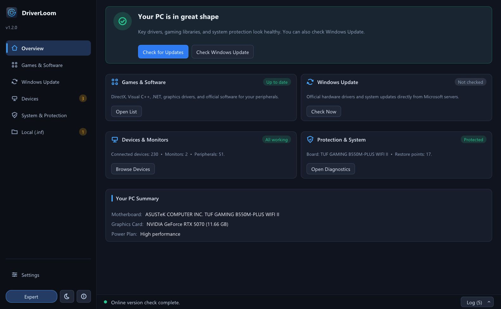

<div align="center">

# DriverLoom

**Native Hybrid Driver, Runtime Component, Windows Update & System Diagnostics Manager for Windows 10 / 11**

-0078D6?style=flat-square&logo=windows)


[](https://github.com/Arvexer/DriverLoom/actions/workflows/build-release.yml)


**English** · **[Русский](README.ru.md)**

</div>

---

**DriverLoom** is a lightweight, standalone `.exe` (~2.2 MB) with zero Electron, WebView, .NET, or external DLL dependencies. Built in pure **C++20** with native Win32 APIs (`SetupAPI`, `CfgMgr32`, `DXGI`, `Windows Update Agent COM`, `WinHTTP`, `WinVerifyTrust`, `SRSetRestorePointW`, `DiInstallDriverW`), **DirectX 11** hardware rendering, and **Dear ImGui (`docking`)**.

---

## Interface Gallery

<table>
  <tr>
    <td width="50%" align="center">
      <b>1. Overview Dashboard &amp; Quick Recommendations</b><br><br>
      
    </td>
    <td width="50%" align="center">
      <b>2. Games, Runtimes, Drivers &amp; Optional Apps</b><br><br>
      
    </td>
  </tr>
  <tr>
    <td width="50%" align="center">
      <b>3. Windows Update (Drivers &amp; System Updates)</b><br><br>
      
    </td>
    <td width="50%" align="center">
      <b>4. PnP Devices, EDID Monitors (Hz) &amp; GPU VRAM</b><br><br>
      
    </td>
  </tr>
  <tr>
    <td width="50%" align="center">
      <b>5. System Protection, Board Drivers &amp; Diagnostics</b><br><br>
      
    </td>
    <td width="50%" align="center">
      <b>6. Light Theme &amp; Simple (Safe) Mode</b><br><br>
      
    </td>
  </tr>
</table>

---

## Key Features

- **Zero Runtime Dependencies**: statically linked CRT (`/MT` on MSVC, `-static -static-libgcc -static-libstdc++` on MinGW-w64) — ships as a single portable executable.
- **Instant `EN / RU / UA` Localization**: auto-detects Windows UI language on first launch and switches live from **Settings**.
- **Dark & Light Themes**: toggles in one click from the sidebar footer or Settings together with the native Windows DWM title bar.
- **Adaptive UI Scaling (`90%–150%`) & Per-Monitor DPI**: switchable interface scale presets (`90% / 100% / 110% / 125% / 150%`) with `PerMonitorV2` DPI awareness and live font/layout reload.
- **Simple vs Expert UI Modes**: keeps everyday driver and runtime updates effortless for casual users while unlocking full low-level PnP and `DriverStore` controls in **Expert** mode.
- **Persistent Preferences**: UI mode, theme, language, UI scale, update auto-check, and driver baseline snapshots persist cleanly in `HKEY_CURRENT_USER\Software\DriverLoom`.
- **Non-Blocking Multithreaded UI**: hardware enumeration, WinHTTP version checks, downloads, and WUA/INF installations run strictly in background worker threads with progress bars and cancellation support.

---

## Application Overview

### Left Sidebar, Settings & Bottom Status Bar
- **Left Sidebar**: switches cleanly between **Overview**, **Games & Software**, **Windows Update**, **Devices**, **System & Protection**, **Local (.inf)** *(Expert mode only)*, and **Settings**, showing live attention badges directly on items.
- **Sidebar Footer**:
  - **Mode Toggle**: switches between `Simple` and `Expert`.
  - **Theme Toggle**: switches between Dark and Light themes (with matching native Windows title bar).
  - **About & Release Checker (`ⓘ`)**: opens the *About DriverLoom* modal with author links, e-mail contact, support link, and non-blocking GitHub Releases checking via WinHTTP.
- **Settings Page**: language selector (`EN / RU / UA`), Dark/Light theme, interface scale (`90% / 100% / 110% / 125% / 150%`), `Simple / Expert` mode, quick `Restart as Administrator` (`UAC`), one-click Restore Point creation, and startup update-check preferences.
- **Bottom Status Bar & Collapsible Log (`Ctrl+L`)**: shows the current operation status and expands a live color-coded log drawer on demand.

### Simple (Safe) vs Expert Mode

| Capability | Simple Mode *(Default)* | Expert Mode |
| :--- | :---: | :---: |
| **Overview** health dashboard & recommended 1-click updates | ✅ | ✅ |
| Gaming runtimes, GPU/chipset drivers & optional vendor suites | ✅ *(Clean card layout)* | ✅ |
| One-click WHQL driver install from **Microsoft Update Catalog** | ✅ | ✅ |
| Noise suppression (ignores disabled `Code 22` / `BTHENUM\COMx` ports) | ✅ | ⚙️ Shows all PnP details |
| System Restore Point before driver/component installs | 🔒 Enforced ON | ⚙️ Toggleable checkbox |
| `Hardware ID`, `INF`, `Instance ID` & PnP actions (`Restart / Disable / Rollback`) | 🚫 Hidden for a clean UI | ✅ Full details & actions |
| **Local (.inf)** tab, `DriverStore` cleanup, `Services` & `Before/After Diff` | 🚫 Hidden | ✅ Full access |
| Hide / restore Windows Update items (`IUpdate::put_IsHidden`) | 🚫 Hidden | ✅ Full access |

---

### Page 1 — Overview
- **Hero Health Card**: summarizes recommended runtime/hardware updates or confirms everything is up to date, with one-click `Install Recommended (N)`, `Rescan PC`, and `Check Windows Update`.
- **4 Status Tiles**: live counts and quick jumps to **Games & Software**, **Windows Update**, **Devices & Monitors**, and **Protection & System**.
- **Quick Recommendations**: lists top actionable updates and onboard driver updates without cluttering the screen with optional bloatware.

### Page 2 — Games & Software
- **Gaming & System Runtimes**: `Visual C++ Redistributable (2010–2022)`, `DirectX End-User Runtime`, `.NET Desktop Runtime 8 / 9 / 10`, `.NET Framework 4.8.1`, `Edge WebView2`, `Vulkan Runtime`, and `OpenAL`.
- **Drivers & GPU / Chipset**: detects NVIDIA, AMD, Intel GPUs, AMD/Intel chipsets, onboard audio, LAN, Wi-Fi, and Bluetooth adapters and resolves WHQL/vendor updates.
- **Optional Third-Party Software (`Optional Apps`)**: detects connected peripherals (mice, keyboards), motherboards (e.g., ASUS Armoury Crate), and monitor companion tools, clearly marking them **Optional** and excluding them from recommended automatic batch installs.
- **Verified Installation**: card-based layout with `All`, `Gaming`, `Drivers & GPU`, and `Optional Apps` filters, `InstallerSha256` manifest verification, Authenticode (`WinVerifyTrust`) trust-chain & expected publisher checks before launch, and automatic Restore Point protection.

### Page 3 — Windows Update
- **Windows Update Agent (WUA COM API)**: welcoming scan prompt on entry, asynchronous driver and optional Windows system update discovery (`IUpdateSession`), download, and installation with live progress (`BeginDownload` / `BeginInstall`).
- **Update Hiding** *(Expert Mode)*: hide or restore unwanted driver updates (`IUpdate::put_IsHidden`), filter `Show hidden (N)`, and guard installs with System Restore Points.

### Page 4 — Devices & Monitors
- **Native PnP Enumeration**: uses `SetupAPI` and `CfgMgr32` with color-coded health badges (`Running / OK`, `No driver`, `Disabled`, Win32 error codes) and a compact summary badge (`Total | Monitors | Attention`).
- **Monitor Inspection (EDID + GDI)**: extracts the physical monitor model, manufacturer, diagonal screen size, and native resolution from EDID alongside the active display mode (`Resolution @ Hz`) and connected GPU.
- **GPU Dedicated VRAM (DXGI)**: displays dedicated video memory per graphics adapter.
- **Filters & Instant Search (`Ctrl+F`)**: `All`, `Attention`, `Monitors`, `Peripherals`, `GPU & Chipset`.
- **One-Click Microsoft Update Catalog Install**: searches WHQL `.cab` packages by `Hardware ID` (`SUBSYS` first, then `VEN/DEV`), verifies Authenticode signature and Microsoft publisher, extracts cleanly with hardened archive limits, and installs via `DiInstallDriverW`.
- **Device Details Card**: displays human-friendly device explanations and quick actions (and full PnP context menu + `oem*.inf` jump in Expert mode).

### Page 5 — System & Protection
- **Motherboard & Windows Readiness Cards**: reads board model and BIOS version from `SMBIOS` (generating a vendor support link), checks pending reboot flags (`CBS / WU`), System Protection policy, and `NTFS TRIM`.
- **Driver Backup & Clean PC Report**: exports third-party drivers or saves/copies a **Markdown (`.md`)**, **TXT**, or **JSON** summary report with automatic sanitization of personal paths and usernames.
- **Built-in Diagnostic Views**:
  1. **Board Drivers**: audits GPU (`[VRAM]`), chipset, LAN, Wi-Fi, audio, and Bluetooth drivers with one-click Microsoft Update Catalog WHQL installation (or inbox Windows driver restoration when applicable).
  2. **Restore Points**: lists recent System Restore points from the Windows Event Log with shortcuts to `rstrui.exe` and System Protection settings.
  3. **Storage & Power**: displays `NVMe` / `SATA AHCI` controller and disk status, `NTFS TRIM` state, and a live Windows power plan switcher (`powrprof.dll`).
  4. **Services & Updates** *(Expert Mode)*: audits critical services (`wuauserv`, `BITS`, `TrustedInstaller`, `CryptSvc`, `PlugPlay`, `VSS`, `UsoSvc`, etc.), enables disabled services, and runs `SFC /scannow`, `DISM CheckHealth`, and `DISM RestoreHealth`.
  5. **Before / After Diff** *(Expert Mode)*: compares current driver versions and device health against a saved baseline (`Driver Updated`, `Issue Fixed`, `New Issue`, `Added`, `Removed`).

### Page 6 — Local (.inf) *(Expert Mode)*
1. **Install from Folder (.inf)**: recursively scans a chosen directory for `.inf` packages and installs via native `DiInstallDriverW` (`newdev.dll`) with optional `DIIRFLAG_FORCE_INF` and Restore Point protection.
2. **DriverStore Backup & Cleanup**: analyzes third-party `oem*.inf` packages (`In Use`, `Old duplicate`, `Stored`), filters by `.inf`/device/vendor/version, exports driver backups, and safely removes old duplicates.

---

## Keyboard Shortcuts

| Shortcut | Action |
| :--- | :--- |
| `F1` | Open *About DriverLoom* & update checker |
| `F5` | Rescan / refresh the active view |
| `Ctrl+F` | Focus device search bar |
| `Ctrl+L` | Expand / collapse the bottom event log drawer |
| `Ctrl+C` | Copy `Hardware ID` or name of the selected device / WU item |
| `Esc` | Clear selection / close details card or log drawer |

---

## Security & Anti-Cheat Compatibility

- **Least Privilege (`asInvoker`)**: [`resources/app.manifest`](resources/app.manifest) avoids forced startup elevation; UAC (`ShellExecuteExW` with `"runas"`) is requested on demand only for actual driver installation, `DriverStore` cleanup, or system repair actions.
- **DLL Search-Order Hijacking Protection**: calls `SetDefaultDllDirectories(LOAD_LIBRARY_SEARCH_SYSTEM32)` at the very start of `WinMain`, enables `/DEPENDENTLOADFLAG:0x800` in MSVC builds, and restricts dynamic `LoadLibraryExW` calls exclusively to `System32` (`LOAD_LIBRARY_SEARCH_SYSTEM32`).
- **SHA-256 & Authenticode Publisher Verification**: validates `InstallerSha256` checksums from WinGet manifests before extraction/launch, verifies downloaded `.cab` packages and vendor installers via Windows `WinVerifyTrust` against expected publishers (`Subject CN/O`), holds open file locks against TOCTOU tampering, and verifies companion binaries inside extracted archives (`DXSETUP.exe`, `DSETUP.dll`, `dsetup32.dll`).
- **Hardened Downloads, Archives & DriverStore Safety**: enforces HTTPS with TLS 1.2/1.3 (`WinHTTP`) and download host allowlists, bounds archive extraction (total size, file count, path traversal, NTFS ADS `:`, and reparse-point checks), safely removes unused `DriverStore` packages via `SetupUninstallOEMInfW` (without forced deletion), and validates canonical `%TEMP%` paths for elevated `CliWorker` logs and cancel files.
- **PE Hardening & Complete Metadata**: [`resources/version.rc`](resources/version.rc) provides full `VERSIONINFO` metadata (`DriverLoom v1.2.0.0`, publisher `Arvexer`); MSVC Release builds enable static CRT (`/MT`), Control Flow Guard (`/GUARD:CF`), ASLR (`/DYNAMICBASE`, `/HIGHENTROPYVA`), DEP (`/NXCOMPAT`), and Shadow Stack (`/CETCOMPAT`) — verified automatically in GitHub Actions CI.
- **Clean Native Code**: prioritizes Win32/COM APIs (`DiInstallDriverW`), uses strict RAII guards for `HDEVINFO` and COM interfaces, safely quotes elevated worker CLI arguments, uses zero telemetry, and uses no executable packers (no UPX or similar).

---

## Project Structure

```text
├── CMakeLists.txt                     # CMake build configuration + FetchContent (ImGui docking)
├── LICENSE                            # MIT License (Arvexer)
├── README.md                          # Documentation (EN)
├── README.ru.md                       # Documentation (RU)
├── resources/
│   ├── app.ico                        # Application icon
│   ├── app.manifest                   # Win32 manifest (asInvoker, PerMonitorV2 DPI, Win10/11)
│   └── version.rc                     # PE VERSIONINFO (DriverLoom v1.2.0.0, Arvexer)
└── src/
    ├── main.cpp                       # WinMain entry point, DX11 swapchain, logo texture, WndProc
    ├── app/
    │   └── CliWorker.hpp/.cpp         # Elevated UAC CLI worker (INF, WUA, services, DriverStore, inbox)
    ├── ui/
    │   ├── AppWidgets.hpp/.cpp        # Dark/Light themes, fonts, DWM, registry prefs & custom widgets
    │   ├── DriverLoomApp.hpp/.cpp     # UI controller: sidebar, settings, status/log drawer, About/updater
    │   ├── TabOverview.cpp            # Page 0: Overview dashboard & Quick Recommendations
    │   ├── TabComponents.cpp          # Page 1: Games, Runtimes, Drivers & Optional Apps
    │   ├── TabWindowsUpdate.cpp       # Page 2: Windows Update
    │   ├── TabDevices.cpp             # Page 3: Devices & Monitors
    │   ├── TabDiagnostics.cpp         # Page 4: System, Protection, Storage/Power & Diff
    │   └── TabLocalInstaller.cpp      # Page 5: Local (.inf) & DriverStore
    ├── common/
    │   ├── AppCommon.hpp              # UTF-8/UTF-16, RAII guards, CLI quoting, logger, UAC runas
    │   └── Localization.hpp           # EN / RU / UA localization (static UI & dynamic logs/statuses)
    └── core/
        ├── DeviceScanner.hpp/.cpp     # PnP SetupAPI/CfgMgr32, monitor EDID, display modes, DXGI VRAM
        ├── HttpClient.hpp/.cpp        # WinHTTP HTTPS client & cancellation registry
        ├── PackageSecurity.hpp/.cpp   # Authenticode TOCTOU lock, safe temp dirs, archive/YAML hardening
        ├── OnlineCatalogClient.hpp/.cpp # MS Update Catalog, winget-pkgs, Vulkan & AMD parsers
        ├── SystemComponentsScanner.*  # Runtime/peripheral/GPU audit & MS Update Catalog CAB installer
        ├── WindowsUpdateManager.*     # WUA COM API search, install progress & update hiding
        ├── LocalDriverInstaller.*     # DiInstallDriverW, DriverStore analysis, backup & cleanup
        ├── SystemRestore.*            # System Restore Point creation (SRSetRestorePointW)
        └── SystemDiagnostics.*        # SMBIOS, services, controllers, NVMe/SATA, power, clean reports
```

---

## Building from Source

Requires a **C++20** compiler (**MSVC** or **MinGW-w64**) and **CMake >= 3.20**. Dear ImGui (`docking`) is fetched automatically via `FetchContent`.

```powershell
cmake -B build -DCMAKE_BUILD_TYPE=Release
cmake --build build -j 8
```

Standalone output binary: `build/DriverLoom.exe`.

<details>
<summary>CLI Arguments for Automation, UI Testing & Screenshot Capture</summary>

```text
--lang ru|uk|en
--mode standard|advanced
--theme dark|light
--scale 90|100|110|125|150
--start-tab 0..6
--diag-section 0..4
--local-section 0..1
--select-device-row <index>
--screenshot <path.bmp>
--capture-suite <output_dir>
```

</details>

---

## Author & Contact

- **Developer:** [Arvexer](https://github.com/Arvexer)
- **Repository:** [github.com/Arvexer/DriverLoom](https://github.com/Arvexer/DriverLoom)
- **E-mail:** [arvexer.dev@proton.me](mailto:arvexer.dev@proton.me?subject=DriverLoom%20Feedback)
- **Support (Ko-fi):** [ko-fi.com/arvexer](https://ko-fi.com/arvexer)

Licensed under the **[MIT License](LICENSE)**.
