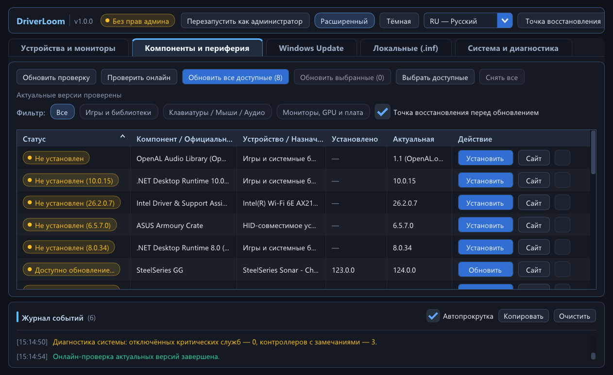
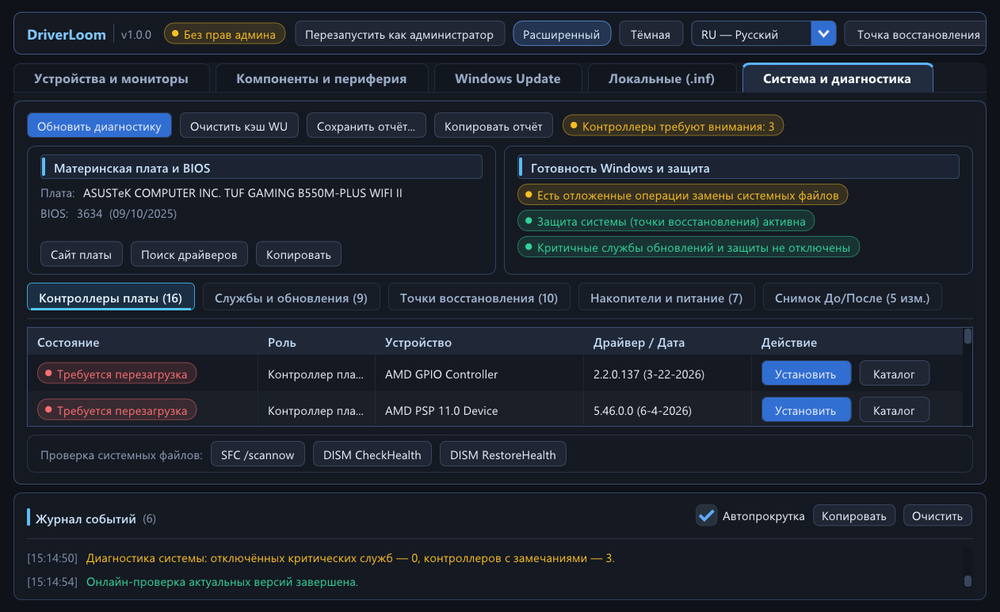
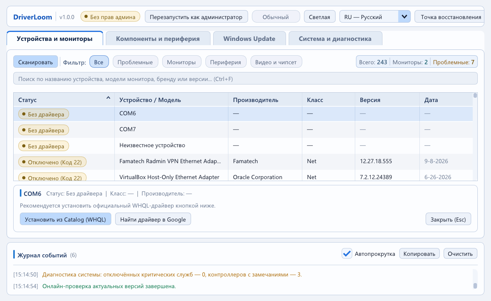

<div align="center">

# DriverLoom

**Нативный гибридный менеджер драйверов, игровых библиотек и системной диагностики для Windows 10 / 11**

-0078D6?style=flat-square&logo=windows)


</div>

---

**DriverLoom** — лёгкий автономный `.exe` (~3.6 МБ) без Electron, WebView, .NET-зависимостей и сторонних DLL. Написан на чистом **C++20** с нативными вызовами Win32 API (`SetupAPI`, `CfgMgr32`, `DXGI`, `Windows Update Agent COM`, `WinHTTP`, `WinVerifyTrust`, `SRSetRestorePointW`, `DiInstallDriverW`), аппаратным рендерингом **DirectX 11** и интерфейсом на **Dear ImGui (`docking`)**.

---

## Скриншоты интерфейса

> Чтобы автоматически снять и обновить все 6 скриншотов прямо с вашего ПК в формате PNG, достаточно один раз запустить **[`capture_screenshots.bat`](capture_screenshots.bat)** (скрипт вызовет `DriverLoom.exe --capture-suite docs\screenshots` и сконвертирует кадры в PNG).

<table>
  <tr>
    <td width="50%" align="center">
      <b>1. Устройства, мониторы (EDID + Гц) и VRAM GPU</b><br><br>
      
    </td>
    <td width="50%" align="center">
      <b>2. Игровые библиотеки, периферия и GPU</b><br><br>
      
    </td>
  </tr>
  <tr>
    <td width="50%" align="center">
      <b>3. Windows Update (драйверы, прогресс, скрытие)</b><br><br>
      
    </td>
    <td width="50%" align="center">
      <b>4. Локальные .inf и хранилище DriverStore</b><br><br>
      
    </td>
  </tr>
  <tr>
    <td width="50%" align="center">
      <b>5. Система, диагностика, NVMe и Снимок До/После</b><br><br>
      
    </td>
    <td width="50%" align="center">
      <b>6. Светлая тема и Обычный (безопасный) режим</b><br><br>
      
    </td>
  </tr>
</table>

---

## Ключевые возможности

- **Полная автономность**: статическая линковка CRT (`/MT` для MSVC или `-static -static-libgcc -static-libstdc++` для MinGW-w64) — один исполняемый файл без установки доп. рантаймов.
- **Мгновенная локализация `RU / UA / EN`**: автоопределение языка интерфейса Windows при первом запуске и переключение «на лету» из выпадающего списка в шапке.
- **Тёмная и светлая темы**: переключаются в 1 клик вместе с системным заголовком окна (DWM).
- **Два уровня интерфейса (Обычный / Расширенный)**: защита от случайных действий для новичков и полный низкоуровневый контроль для техспециалистов.
- **Сохранение пользовательских настроек**: выбранный режим, тема, язык и базовый снимок драйверов сохраняются между запусками в реестре (`HKEY_CURRENT_USER\Software\DriverLoom`).
- **Неблокирующий многопоточный UI**: всё сканирование, HTTP-загрузки и установки выполняются в фоновых потоках с отображением прогресса, фаз и возможностью отмены.

---

## Подробный обзор всех разделов приложения

### Верхняя панель управления (Шапка)
- **Индикатор прав доступа**: `Администратор` или `Без прав админа` с кнопкой быстрого перезапуска с повышением прав (`UAC`).
- **Переключатель режима**: `Режим: Обычный` / `Режим: Расширенный`.
- **Переключатель оформления**: `Тема: Тёмная` / `Тема: Светлая`.
- **Выбор языка**: выпадающий список `RU — Русский` / `UA — Українська` / `EN — English`.
- **Быстрая точка восстановления**: создание точки восстановления Windows в 1 клик с любого экрана.

### Обычный (безопасный) vs Расширенный режим

| Возможность | Обычный режим *(по умолчанию)* | Расширенный режим |
| :--- | :---: | :---: |
| Поиск и установка WHQL-драйверов из **Microsoft Update Catalog** | ✅ | ✅ |
| Обновление игровых библиотек, ПО периферии и утилит мониторов | ✅ | ✅ |
| Точка восстановления перед установкой обновлений | 🔒 Всегда включена | ⚙️ Управляется чекбоксом |
| Безопасный экспорт резервной копии драйверов | ✅ В «Системе и диагностике» | ✅ В `DriverStore` |
| Колонка `Hardware ID`, `INF`, `Instance ID` | 🚫 Скрыты для чистоты UI | ✅ Полные сведения |
| Контекстное меню PnP (`Перезапуск / Откл. / Откат / Удаление`) | 🚫 Скрыты опасные действия | ✅ Полный доступ |
| Вкладка **«Локальные (.inf)»** и очистка `DriverStore` | 🚫 Скрыта | ✅ Полный доступ |
| Скрытие/возврат обновлений WU (`IUpdate::put_IsHidden`) | 🚫 Скрыто | ✅ Полный доступ |

---

### Вкладка 1 — Устройства и мониторы
- **Нативное сканирование PnP** через `SetupAPI` и `CfgMgr32` с цветовыми статусами (`Работает`, `Без драйвера`, `Отключено`, коды ошибок Windows) и некликабельной компактной сводкой справа (`Всего | Мониторы | Проблемные`).
- **Анализ мониторов (EDID + GDI)**: извлекает из реестра реальную модель монитора, производителя, физическую диагональ в дюймах и нативное разрешение, а также определяет активный режим (`Разрешение @ Гц`) и подключённую видеокарту.
- **Объём VRAM видеокарт (DXGI)**: отображает выделенную видеопамять для каждого графического адаптера.
- **Фильтры и мгновенный поиск (`Ctrl+F`)**: `Все`, `Проблемные`, `Мониторы`, `Периферия`, `Видео и чипсет`.
- **Установка в 1 клик из Microsoft Update Catalog**: по нажатию кнопки в карточке устройства или контекстном меню автоматически ищет свежий WHQL `.cab` пакет по `Hardware ID`, скачивает, проверяет цифровую подпись Authenticode, распаковывает и устанавливает драйвер.
- **Нижняя карточка деталей и горячие действия**: отображает сводку выбранного устройства, кнопки установки WHQL, перезапуска, отката, копирования ID и прямого перехода к `oem*.inf` в `DriverStore`.

### Вкладка 2 — Компоненты и периферия
- **Игровые и системные библиотеки**: `Visual C++ Redistributable`, `DirectX`, `.NET Desktop Runtime 8 / 9 / 10`, `.NET Framework 4.8.1`, `WebView2`, `Vulkan Runtime`, `OpenAL`.
- **Официальное ПО периферии, мониторов и чипсетов**: автоматически определяет установленное оборудование (мониторы, мыши, клавиатуры, аудио, сетевые/Wi-Fi адаптеры, GPU/чипсет AMD и Intel DSA) и проверяет свежие версии локально и онлайн.
- **Пакетное и выборочное обновление**: кнопки `Обновить все доступные (N)` и `Обновить выбранные (N)` с чекбоксами по строкам, проверкой подписи загрузчиков (`WinVerifyTrust`) и автоматическим созданием точки восстановления Windows перед установкой.

### Вкладка 3 — Windows Update
- **Интеграция с Windows Update Agent (WUA COM API)**: асинхронный поиск драйверов и обновлений Windows (`IUpdateSession`), загрузка и установка с плавной шкалой прогресса (`BeginDownload` / `BeginInstall`).
- **Управление нежелательными драйверами** *(в расширенном режиме)*: скрытие и возврат обновлений через `IUpdate::put_IsHidden`, фильтр `Показывать скрытые (N)` и защита точкой восстановления перед установкой.

### Вкладка 4 — Локальные (.inf) *(в расширенном режиме)*
Разделена на два подраздела:
1. **Установка из папки (.inf)**: рекурсивный поиск `.inf` файлов в выбранной папке и нативная установка через `DiInstallDriverW` (`newdev.dll`) с опциональным флагом `DIIRFLAG_FORCE_INF` и точкой восстановления.
2. **Бэкап и хранилище DriverStore**: анализ сторонних пакетов `oem*.inf` (`Активен`, `Старый дубликат`, `В хранилище`), поиск по имени `.inf`/устройству/поставщику/версии, экспорт резервной копии драйверов перед переустановкой Windows и безопасное пакетное удаление старых дубликатов.

### Вкладка 5 — Система и диагностика
- **Карточки платы и готовности Windows**: чтение модели платы и BIOS из `SMBIOS` (с генерацией ссылки на страницу поддержки конкретной модели платы), проверка отложенной перезагрузки (`CBS/WU`), политики защиты системы и `NTFS TRIM`.
- **Экспорт обезличенного отчёта о ПК**: сохранение в файл **Markdown (`.md`)**, **TXT** или **JSON**, либо копирование в буфер обмена (автоматическая санитизация личных путей и имён пользователей).
- **5 встроенных диагностических подразделов**:
  1. **Ключевые контроллеры платы**: аудит драйверов GPU (`[VRAM]`), чипсета, сети LAN, Wi-Fi, аудио и Bluetooth с установкой WHQL из Catalog в 1 клик.
  2. **Службы Windows и обновления**: проверка состояния критичных служб (`wuauserv`, `BITS`, `TrustedInstaller`, `CryptSvc`, `PlugPlay`, `VSS`, `UsoSvc` и др.) и включение отключённых служб, + инструменты восстановления в нижней панели (`SFC /scannow`, `DISM CheckHealth`, `DISM RestoreHealth`).
  3. **Точки восстановления**: история точек восстановления из журнала событий Windows и быстрый вызов `rstrui.exe` / настройки защиты диска.
  4. **Накопители и питание**: состояние контроллеров `NVMe` (`stornvme.inf`) / `SATA AHCI` и дисков, статус `NTFS TRIM` и переключатель схем электропитания Windows (`powrprof.dll`).
  5. **Снимок До / После**: сравнение текущих версий и статусов драйверов с сохранённым базовым снимком (`Обновлён драйвер`, `Исправлено`, `Новая ошибка`, `Добавлено`, `Удалено`), фиксация нового снимка «До» и копирование списка изменений.

---

## Горячие клавиши

| Комбинация | Действие |
| :--- | :--- |
| `F5` | Пересканировать / обновить текущую вкладку |
| `Ctrl+F` | Перейти в поле поиска устройств |
| `Ctrl+C` | Копировать `Hardware ID` / название выбранного устройства или обновления WU |
| `Esc` | Снять выделение и закрыть карточку деталей |

---

## Безопасность и совместимость (АВ / Античиты)

- **Минимальные привилегии (`asInvoker`)**: в [`resources/app.manifest`](resources/app.manifest) отключён принудительный `requireAdministrator`; запрос UAC (`ShellExecuteExW` с `"runas"`) выполняется только при реальной установке, очистке или изменении системных параметров.
- **Заполненный `VERSIONINFO`**: корректные метаданные продукта, версии (`1.0.0.0`) и издателя (`Arvexer`) в [`resources/version.rc`](resources/version.rc).
- **Проверка цифровых подписей**: все скачиваемые установщики и `.cab` пакеты проверяются через Windows **Authenticode (`WinVerifyTrust`)** перед запуском.
- **Чистый нативный код**: предпочтение нативных Win32/COM API (`DiInstallDriverW`), строгое RAII-освобождение `HDEVINFO` / дескрипторов / COM-объектов, отсутствие упаковщиков исполняемых файлов (UPX и аналогов).

---

## Структура проекта

```text
├── CMakeLists.txt                     # Конфигурация CMake + FetchContent (ImGui docking)
├── capture_screenshots.bat            # Автоматическое снятие всех 6 PNG-скриншотов в docs/screenshots/
├── resources/
│   ├── app.ico                        # Иконка приложения
│   ├── app.manifest                   # Манифест (asInvoker, PerMonitorV2 DPI, Win10/11)
│   └── version.rc                     # PE VERSIONINFO (DriverLoom v1.0.0.0, Arvexer)
└── src/
    ├── main.cpp                       # Точка входа WinMain, DirectX 11 swapchain, WndProc и цикл рендера
    ├── app/
    │   └── CliWorker.hpp/.cpp         # Повышенный UAC CLI-воркер (установка, WUA, службы, DriverStore)
    ├── ui/
    │   ├── AppWidgets.hpp/.cpp        # Темы Dark/Light, шрифты, DWM, настройки в реестре и UI-виджеты
    │   ├── DriverLoomApp.hpp/.cpp     # Контроллер UI: шапка, журнал событий, снимок «До/После», клавиши
    │   ├── TabDevices.cpp             # Вкладка 1: Устройства и мониторы
    │   ├── TabComponents.cpp          # Вкладка 2: Компоненты и периферия
    │   ├── TabWindowsUpdate.cpp       # Вкладка 3: Windows Update
    │   ├── TabLocalInstaller.cpp      # Вкладка 4: Локальные (.inf) и хранилище DriverStore
    │   └── TabDiagnostics.cpp         # Вкладка 5: Система, диагностика, питание и «Снимок До/После»
    ├── common/
    │   ├── AppCommon.hpp              # UTF-8/UTF-16, RAII-гарды, логгер, UAC runas, Authenticode
    │   └── Localization.hpp           # Локализация RU / UA / EN (статика + динамические статусы/логи)
    └── core/
        ├── DeviceScanner.hpp/.cpp     # PnP SetupAPI/CfgMgr32, EDID мониторов, GDI режимы, DXGI VRAM
        ├── SystemComponentsScanner.*  # Аудит библиотек/периферии/GPU и установка из MS Update Catalog
        ├── WindowsUpdateManager.*     # Поиск, установка и скрытие обновлений через WUA COM API
        ├── LocalDriverInstaller.*     # DiInstallDriverW, анализ/бэкап/очистка DriverStore
        ├── SystemRestore.*            # Создание точек восстановления (SRSetRestorePointW)
        └── SystemDiagnostics.*        # SMBIOS, службы, контроллеры, NVMe/SATA, питание, отчёты
```

---

## Сборка из исходников

Требуется компилятор **C++20** (**MSVC** или **MinGW-w64**) и **CMake >= 3.20**. Библиотека Dear ImGui (`docking`) загружается автоматически через `FetchContent`.

```powershell
cmake -B build -DCMAKE_BUILD_TYPE=Release
cmake --build build -j 8
```

Готовый автономный бинарник: `build/DriverLoom.exe`.

<details>
<summary>CLI-аргументы для автоматизации, отладки интерфейса и снятия скриншотов</summary>

```text
--lang ru|uk|en
--mode standard|advanced
--theme dark|light
--start-tab 0..4
--diag-section 0..4
--local-section 0..1
--select-device-row <индекс>
--screenshot <путь.bmp>
--capture-suite <папка_для_серии_скриншотов>
```

</details>
