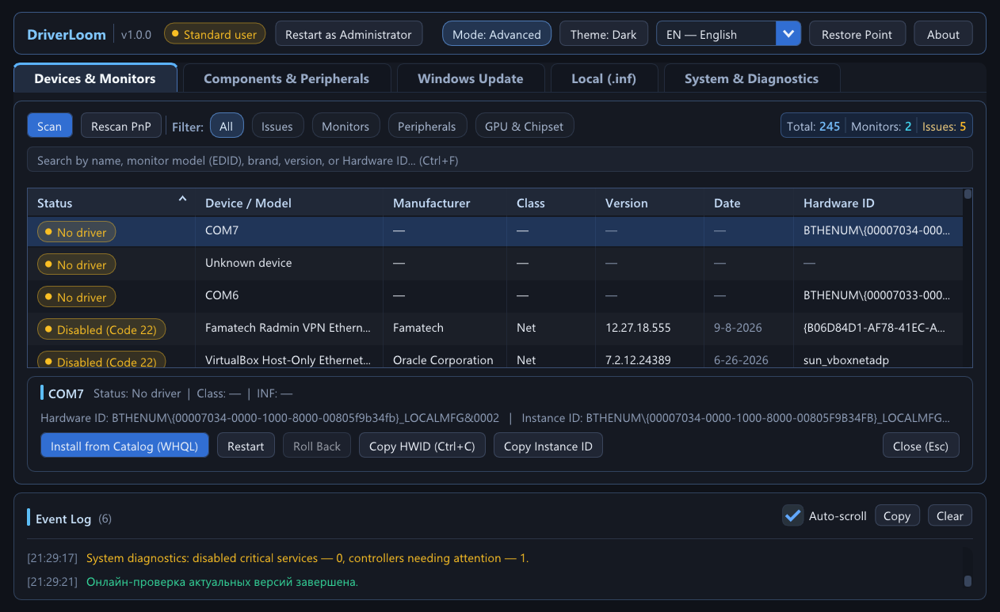
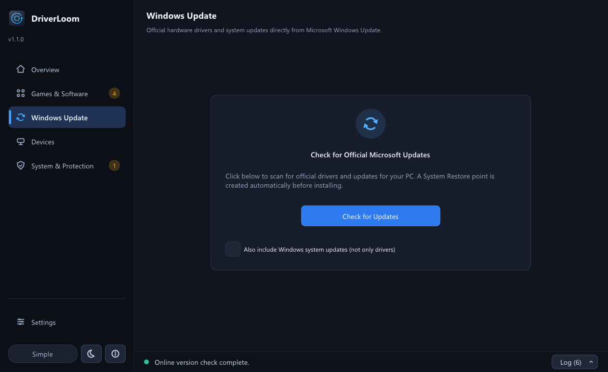
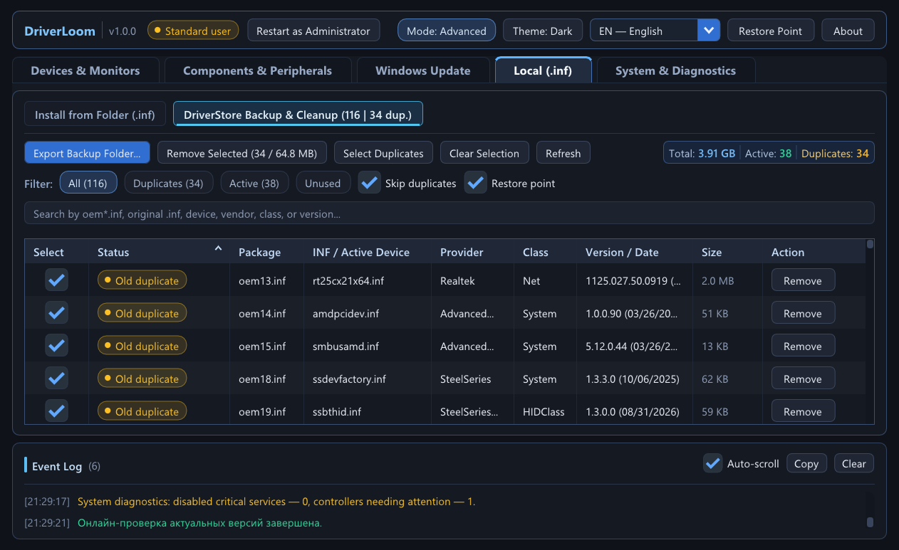

<div align="center">

# DriverLoom

**Native Hybrid Driver, Runtime Component, Windows Update & System Diagnostics Manager for Windows 10 / 11**

-0078D6?style=flat-square&logo=windows)


**English** · **[Русский](README.ru.md)**

</div>

---

**DriverLoom** is a lightweight, standalone `.exe` (~4.0 MB) with zero Electron, WebView, .NET, or external DLL dependencies. Built in pure **C++20** with native Win32 APIs (`SetupAPI`, `CfgMgr32`, `DXGI`, `Windows Update Agent COM`, `WinHTTP`, `WinVerifyTrust`, `SRSetRestorePointW`, `DiInstallDriverW`), **DirectX 11** hardware rendering, and **Dear ImGui (`docking`)**.

---

## Interface Gallery

<table>
  <tr>
    <td width="50%" align="center">
      <b>1. PnP Devices, EDID Monitors (Hz) & GPU VRAM</b><br><br>
      
    </td>
    <td width="50%" align="center">
      <b>2. Gaming Runtimes, Peripherals & GPU Software</b><br><br>
      
    </td>
  </tr>
  <tr>
    <td width="50%" align="center">
      <b>3. Windows Update (Drivers, Progress & Hiding)</b><br><br>
      
    </td>
    <td width="50%" align="center">
      <b>4. Local .inf Installer & DriverStore Management</b><br><br>
      
    </td>
  </tr>
  <tr>
    <td width="50%" align="center">
      <b>5. System Diagnostics, Storage & Before/After Diff</b><br><br>
      
    </td>
    <td width="50%" align="center">
      <b>6. Light Theme & Standard (Safe) UI Mode</b><br><br>
      
    </td>
  </tr>
</table>

---

## Key Features

- **Zero Runtime Dependencies**: statically linked CRT (`/MT` on MSVC, `-static -static-libgcc -static-libstdc++` on MinGW-w64) — ships as a single portable executable.
- **Instant `EN / RU / UA` Localization**: auto-detects Windows UI language on first launch and switches live from the header dropdown.
- **Dark & Light Themes**: toggles in one click together with the native Windows DWM title bar.
- **Standard vs Advanced UI Modes**: keeps daily driver updates safe for casual users while unlocking full low-level PnP and `DriverStore` controls for power users.
- **Persistent Preferences**: UI mode, theme, language, update auto-check, and driver baseline snapshots persist cleanly in `HKEY_CURRENT_USER\Software\DriverLoom`.
- **Non-Blocking Multithreaded UI**: hardware enumeration, WinHTTP version checks, downloads, and WUA/INF installations run strictly in background worker threads with progress bars and cancellation support.

---

## Application Overview

### Top Control Bar (Header)
- **About & Release Checker (`About`)**: opens the *About DriverLoom* modal with author links, e-mail contact, and non-blocking GitHub Releases update checking via WinHTTP.
- **Privilege Badge**: shows `Administrator` or `Standard user` alongside a one-click `Restart as Administrator` (`UAC`) button.
- **UI Mode Toggle**: switches between `Mode: Standard` and `Mode: Advanced`.
- **Theme Toggle**: switches between `Theme: Dark` and `Theme: Light`.
- **Language Selector**: live `EN — English` / `RU — Русский` / `UA — Українська` dropdown.
- **Quick Restore Point**: creates a Windows System Restore Point in one click from anywhere in the app.

### Standard (Safe) vs Advanced Mode

| Capability | Standard Mode *(Default)* | Advanced Mode |
| :--- | :---: | :---: |
| One-click WHQL driver install from **Microsoft Update Catalog** | ✅ | ✅ |
| Gaming runtimes, peripheral apps & monitor utility updates | ✅ | ✅ |
| System Restore Point before driver/component installs | 🔒 Enforced ON | ⚙️ Toggleable checkbox |
| Safe third-party driver backup export | ✅ In System & Diagnostics | ✅ In `DriverStore` |
| `Hardware ID`, `INF`, `Instance ID` details | 🚫 Hidden for a clean UI | ✅ Full details |
| PnP context actions (`Restart / Disable / Rollback / Uninstall`) | 🚫 Destructive actions hidden | ✅ Full access |
| **Local (.inf)** tab & `DriverStore` package cleanup | 🚫 Hidden | ✅ Full access |
| Hide / restore Windows Update items (`IUpdate::put_IsHidden`) | 🚫 Hidden | ✅ Full access |

---

### Tab 1 — Devices & Monitors
- **Native PnP Enumeration**: uses `SetupAPI` and `CfgMgr32` with color-coded health badges (`Working`, `No Driver`, `Disabled`, Win32 error codes) and a compact summary chip (`Total | Monitors | Issues`).
- **Monitor Inspection (EDID + GDI)**: extracts the physical monitor model, manufacturer, diagonal screen size, and native resolution from EDID alongside the active display mode (`Resolution @ Hz`) and connected GPU.
- **GPU Dedicated VRAM (DXGI)**: displays dedicated video memory per graphics adapter.
- **Category Filters & Search (`Ctrl+F`)**: `All`, `Issues`, `Monitors`, `Peripherals`, `Display & Chipset`.
- **One-Click Microsoft Update Catalog Install**: searches WHQL `.cab` packages by `Hardware ID` (`SUBSYS` first, then `VEN/DEV`), downloads via WinHTTP, verifies the Authenticode signature, extracts cleanly, and installs via `DiInstallDriverW`.
- **Device Details Card**: displays full hardware metadata and quick actions (WHQL install, restart, driver rollback, copy IDs, and jump directly to `oem*.inf` in `DriverStore`).

### Tab 2 — Components & Peripherals
- **Gaming & System Runtimes**: `Visual C++ Redistributable (2010–2022)`, `DirectX End-User Runtime`, `.NET Desktop Runtime 8 / 9 / 10`, `.NET Framework 4.8.1`, `Edge WebView2`, `Vulkan Runtime`, and `OpenAL`.
- **Peripheral, Monitor & Chipset Software**: detects connected brands/hardware (monitors, mice, keyboards, audio devices, LAN/Wi-Fi, AMD Chipset & GPU, Intel DSA) and checks current versions locally and online.
- **Batch & Selective Updates**: `Update All Available (N)` and `Update Selected (N)` with per-row checkboxes, Authenticode signature checks (`WinVerifyTrust`), and automatic System Restore Point creation before installation.

### Tab 3 — Windows Update
- **Windows Update Agent (WUA COM API)**: asynchronous driver and OS update discovery (`IUpdateSession`), download, and installation with live progress (`BeginDownload` / `BeginInstall`).
- **Update Hiding** *(Advanced Mode)*: hide or restore unwanted driver updates (`IUpdate::put_IsHidden`), filter `Show hidden (N)`, and guard installs with System Restore Points.

### Tab 4 — Local (.inf) *(Advanced Mode)*
Split into two sub-sections:
1. **Install from Folder (.inf)**: recursively scans a chosen directory for `.inf` packages and installs via native `DiInstallDriverW` (`newdev.dll`) with optional `DIIRFLAG_FORCE_INF` and Restore Point protection.
2. **DriverStore Backup & Cleanup**: analyzes third-party `oem*.inf` packages (`Active`, `Old Duplicate`, `In Store`), filters by `.inf`/device/vendor/version, exports clean driver backups, and safely removes old duplicates.

### Tab 5 — System & Diagnostics
- **Motherboard & Windows Readiness Cards**: reads board model and BIOS version from `SMBIOS` (generating a vendor support link), checks pending reboot flags (`CBS / WU`), System Protection policy, and `NTFS TRIM`.
- **Privacy-Clean PC Report Export**: saves or copies a **Markdown (`.md`)**, **TXT**, or **JSON** summary report with automatic sanitization of personal paths and usernames.
- **5 Built-in Diagnostic Views**:
  1. **Board Controllers**: audits GPU (`[VRAM]`), chipset, LAN, Wi-Fi, audio, and Bluetooth drivers with one-click Microsoft Update Catalog WHQL installation (or inbox Windows driver restoration when applicable).
  2. **Services & Updates**: checks critical services (`wuauserv`, `BITS`, `TrustedInstaller`, `CryptSvc`, `PlugPlay`, `VSS`, `UsoSvc`, etc.), enables disabled services, and provides system repair shortcuts (`SFC /scannow`, `DISM CheckHealth`, `DISM RestoreHealth`).
  3. **Restore Points**: lists recent System Restore points from the Windows Event Log with shortcuts to `rstrui.exe` and System Protection settings.
  4. **Storage & Power**: displays `NVMe` / `SATA AHCI` controller and disk status, `NTFS TRIM` state, and a live Windows power plan switcher (`powrprof.dll`).
  5. **Before / After Snapshot**: compares current driver versions and device health against a saved baseline (`Driver Updated`, `Issue Fixed`, `New Issue`, `Added`, `Removed`), saves a new baseline, and copies the diff summary.

---

## Keyboard Shortcuts

| Shortcut | Action |
| :--- | :--- |
| `F1` | Open *About DriverLoom* & update checker |
| `F5` | Rescan / refresh the active tab |
| `Ctrl+F` | Focus device search bar |
| `Ctrl+C` | Copy `Hardware ID` or name of the selected device / WU item |
| `Esc` | Clear selection / close details card |

---

## Security & Anti-Cheat Compatibility

- **Least Privilege (`asInvoker`)**: [`resources/app.manifest`](resources/app.manifest) avoids forced startup elevation; UAC (`ShellExecuteExW` with `"runas"`) is requested on demand only for actual driver installation, `DriverStore` cleanup, or system repair actions.
- **Complete PE Metadata**: [`resources/version.rc`](resources/version.rc) provides full `VERSIONINFO` metadata (`DriverLoom v1.0.0.0`, publisher `Arvexer`).
- **Authenticode Verification**: downloaded `.cab` packages and vendor installers are verified using Windows `WinVerifyTrust` before execution.
- **Clean Native Code**: prioritizes Win32/COM APIs (`DiInstallDriverW`), uses strict RAII guards for `HDEVINFO` and COM interfaces, and uses no executable packers (no UPX or similar).

---

## Project Structure

```text
├── CMakeLists.txt                     # CMake build configuration + FetchContent (ImGui docking)
├── LICENSE                            # MIT License (Arvexer)
├── README.md                          # Documentation (EN)
├── README.ru.md                       # Documentation (RU)
├── capture_screenshots.bat            # Automated 6-screenshot PNG capture script
├── resources/
│   ├── app.ico                        # Application icon
│   ├── app.manifest                   # Win32 manifest (asInvoker, PerMonitorV2 DPI, Win10/11)
│   └── version.rc                     # PE VERSIONINFO (DriverLoom v1.0.0.0, Arvexer)
└── src/
    ├── main.cpp                       # WinMain entry point, DirectX 11 swapchain, WndProc, render loop
    ├── app/
    │   └── CliWorker.hpp/.cpp         # Elevated UAC CLI worker (INF, WUA, services, DriverStore, inbox)
    ├── ui/
    │   ├── AppWidgets.hpp/.cpp        # Dark/Light themes, fonts, DWM, registry prefs & custom widgets
    │   ├── DriverLoomApp.hpp/.cpp     # UI controller: header, About/updater, log panel, baseline diff
    │   ├── TabDevices.cpp             # Tab 1: Devices & Monitors
    │   ├── TabComponents.cpp          # Tab 2: Components & Peripherals
    │   ├── TabWindowsUpdate.cpp       # Tab 3: Windows Update
    │   ├── TabLocalInstaller.cpp      # Tab 4: Local (.inf) & DriverStore
    │   └── TabDiagnostics.cpp         # Tab 5: System, Diagnostics, Storage/Power & Before/After
    ├── common/
    │   ├── AppCommon.hpp              # UTF-8/UTF-16, RAII guards, logger, UAC runas, Authenticode
    │   └── Localization.hpp           # EN / RU / UA localization (static UI & dynamic logs/statuses)
    └── core/
        ├── DeviceScanner.hpp/.cpp     # PnP SetupAPI/CfgMgr32, monitor EDID, display modes, DXGI VRAM
        ├── SystemComponentsScanner.*  # Runtime/peripheral/GPU audit & MS Update Catalog CAB installer
        ├── WindowsUpdateManager.*     # WUA COM API search, install progress & update hiding
        ├── LocalDriverInstaller.*     # DiInstallDriverW, DriverStore analysis, backup & cleanup
        ├── SystemRestore.*            # System Restore Point creation (SRSetRestorePointW)
        └── SystemDiagnostics.*        # SMBIOS, services, controllers, NVMe/SATA, power, clean reports
```

---

## Building from Source

Requires a **C++20** compiler (**MSVC** or **MinGW-w64**) and **CMake >= 3.20**. Dear ImGui (`docking`) is fetched automatically via `FetchContent`.

```powershell
cmake -B build -DCMAKE_BUILD_TYPE=Release
cmake --build build -j 8
```

Standalone output binary: `build/DriverLoom.exe`.

<details>
<summary>CLI Arguments for Automation, UI Testing & Screenshot Capture</summary>

Run [`capture_screenshots.bat`](capture_screenshots.bat) to recapture all 6 PNG screenshots in `docs/screenshots/` (`en` by default, or pass a language code such as `capture_screenshots.bat ru`).

```text
--lang ru|uk|en
--mode standard|advanced
--theme dark|light
--start-tab 0..4
--diag-section 0..4
--local-section 0..1
--select-device-row <index>
--screenshot <path.bmp>
--capture-suite <output_dir>
```

</details>

---

## Author & Contact

- **Developer:** [Arvexer](https://github.com/Arvexer)
- **Repository:** [github.com/Arvexer/DriverLoom](https://github.com/Arvexer/DriverLoom)
- **E-mail:** [arvexer.dev@proton.me](mailto:arvexer.dev@proton.me?subject=DriverLoom%20Feedback)
- **Support (Ko-fi):** [ko-fi.com/arvexer](https://ko-fi.com/arvexer)

Licensed under the **[MIT License](LICENSE)**.
