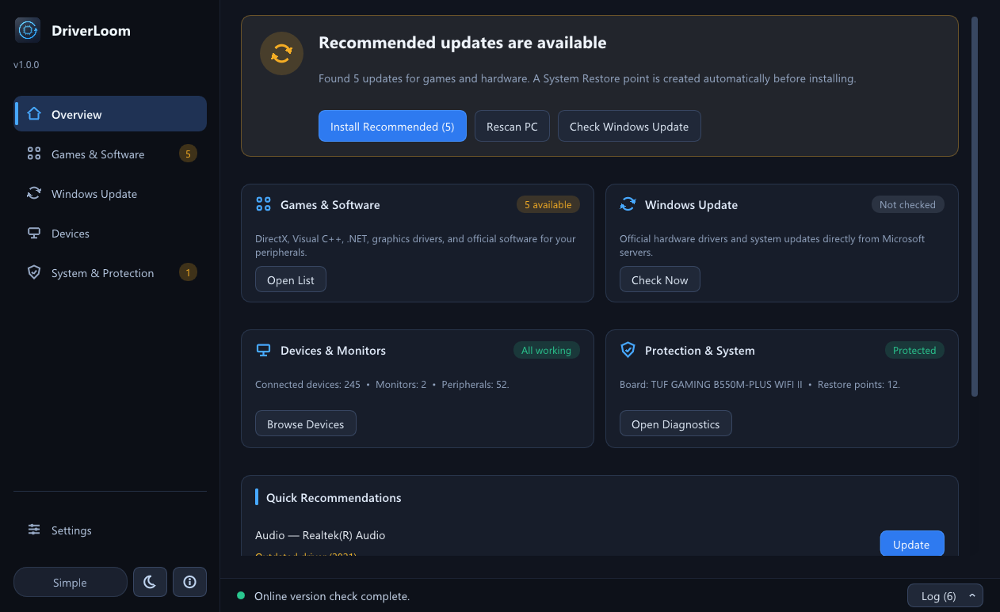
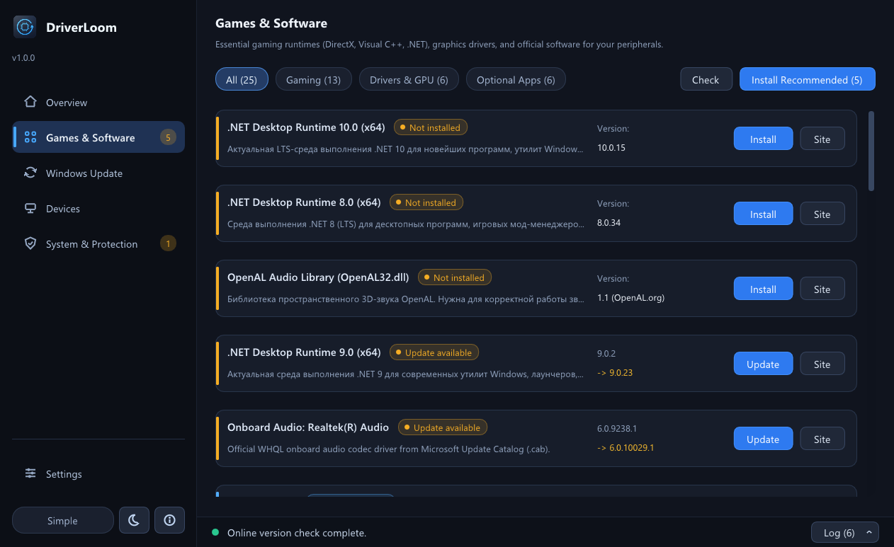
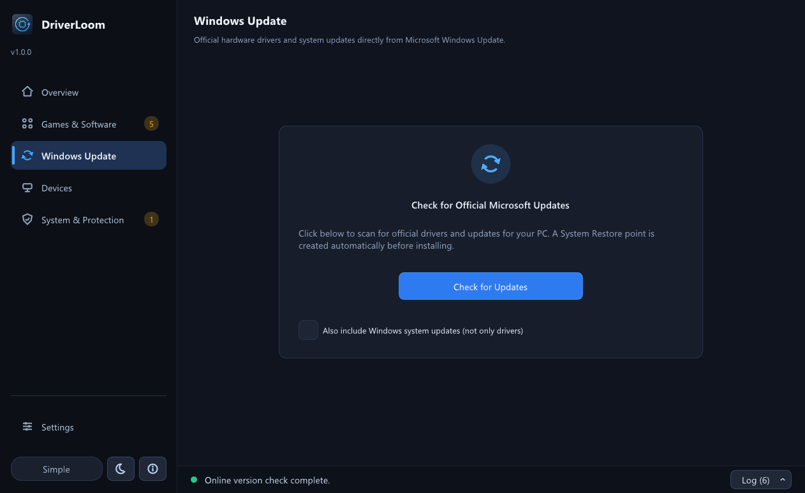
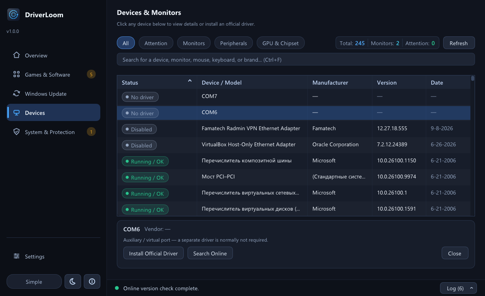
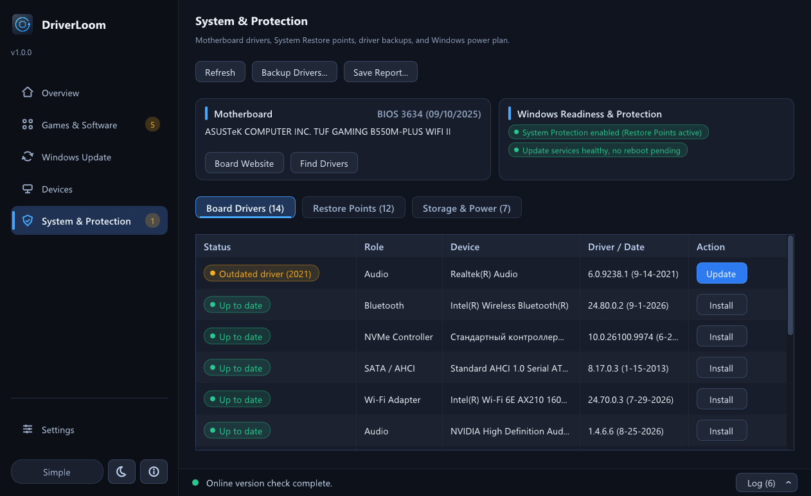
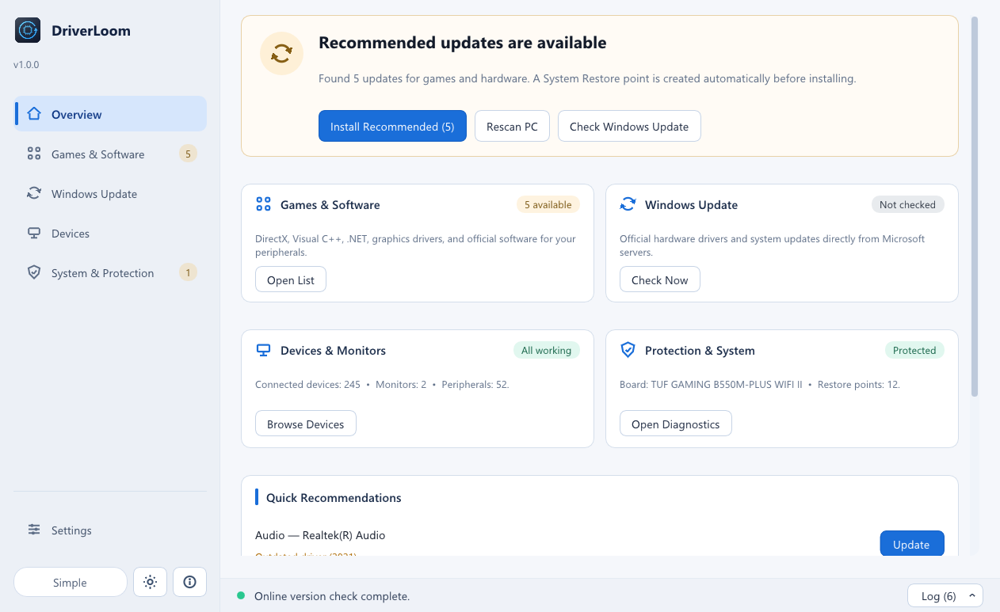

<div align="center">

# DriverLoom

**Нативный гибридный менеджер драйверов, игровых библиотек и системной диагностики для Windows 10 / 11**

-0078D6?style=flat-square&logo=windows)


**[English](README.md)** · **Русский**

</div>

---

**DriverLoom** — лёгкий автономный `.exe` (~4.0 МБ) без Electron, WebView, .NET-зависимостей и сторонних DLL. Написан на чистом **C++20** с нативными вызовами Win32 API (`SetupAPI`, `CfgMgr32`, `DXGI`, `Windows Update Agent COM`, `WinHTTP`, `WinVerifyTrust`, `SRSetRestorePointW`, `DiInstallDriverW`), аппаратным рендерингом **DirectX 11** и интерфейсом на **Dear ImGui (`docking`)**.

---

## Скриншоты интерфейса

<table>
  <tr>
    <td width="50%" align="center">
      <b>1. Обзор и быстрые рекомендации</b><br><br>
      
    </td>
    <td width="50%" align="center">
      <b>2. Игры, библиотеки, драйверы и доп. ПО</b><br><br>
      
    </td>
  </tr>
  <tr>
    <td width="50%" align="center">
      <b>3. Обновления Windows (драйверы и система)</b><br><br>
      
    </td>
    <td width="50%" align="center">
      <b>4. Устройства, мониторы (EDID + Гц) и VRAM GPU</b><br><br>
      
    </td>
  </tr>
  <tr>
    <td width="50%" align="center">
      <b>5. Защита системы, драйверы платы и диагностика</b><br><br>
      
    </td>
    <td width="50%" align="center">
      <b>6. Светлая тема и Обычный (безопасный) режим</b><br><br>
      
    </td>
  </tr>
</table>

---

## Ключевые возможности

- **Полная автономность**: статическая линковка CRT (`/MT` для MSVC или `-static -static-libgcc -static-libstdc++` для MinGW-w64) — один исполняемый файл без установки доп. рантаймов.
- **Мгновенная локализация `RU / UA / EN`**: автоопределение языка интерфейса Windows при первом запуске и переключение «на лету» в **Настройках**.
- **Тёмная и светлая темы**: переключаются в 1 клик кнопкой в боковой панели или в Настройках вместе с системным заголовком окна (DWM).
- **Два уровня интерфейса (Обычный / Эксперт)**: защита от случайных действий и понятная подача для новичков + полный низкоуровневый контроль в режиме **Эксперт**.
- **Сохранение пользовательских настроек**: выбранный режим, тема, язык, автопроверка обновлений и базовый снимок драйверов сохраняются между запусками в реестре (`HKEY_CURRENT_USER\Software\DriverLoom`).
- **Неблокирующий многопоточный UI**: всё сканирование, HTTP-загрузки и установки выполняются в фоновых потоках с отображением прогресса, фаз и возможностью отмены.

---

## Подробный обзор всех разделов приложения

### Боковая панель, Настройки и строка состояния
- **Боковая панель навигации**: переключает разделы **Обзор**, **Игры и ПО**, **Обновления Windows**, **Устройства**, **Защита и система**, **Локальные (.inf)** *(только в режиме «Эксперт»)* и **Настройки**, отображая бейджи доступных действий.
- **Нижняя панель меню**:
  - **Переключатель режима**: `Обычный` / `Эксперт`.
  - **Переключатель темы**: тёмная или светлая тема с синхронизацией заголовка окна Windows.
  - **О приложении (`ⓘ`)**: окно с контактами автора, ссылками на GitHub, поддержкой и фоновой проверкой релизов через WinHTTP.
- **Страница «Настройки»**: выбор языка (`RU / UA / EN`), темы, режима интерфейса, кнопка перезапуска с правами администратора (`UAC`), создание точки восстановления и настройка автопроверки обновлений.
- **Нижняя строка статуса и журнал (`Ctrl+L`)**: показывает текущую операцию и по нажатию кнопки «Журнал» раскрывает цветную панель событий.

### Обычный (безопасный) vs режим «Эксперт»

| Возможность | Обычный режим *(по умолчанию)* | Режим «Эксперт» |
| :--- | :---: | :---: |
| Стартовая сводка **Обзор** и рекомендуемые обновления в 1 клик | ✅ | ✅ |
| Игровые библиотеки, драйверы GPU/чипсета и доп. ПО | ✅ *(Карточный вид)* | ✅ |
| Поиск и установка WHQL-драйверов из **Microsoft Update Catalog** | ✅ | ✅ |
| Фильтрация лишнего шума (игнор отключённых `Code 22` и `BTHENUM\COMx`) | ✅ | ⚙️ Полный список PnP |
| Точка восстановления перед установкой обновлений | 🔒 Всегда включена | ⚙️ Управляется чекбоксом |
| `Hardware ID`, `INF`, `Instance ID` и PnP-действия (`Перезапуск / Откл. / Откат`) | 🚫 Скрыты для чистоты UI | ✅ Полные сведения и действия |
| **Локальные (.inf)**, очистка `DriverStore`, `Службы` и `Снимок До/После` | 🚫 Скрыты | ✅ Полный доступ |
| Скрытие/возврат обновлений WU (`IUpdate::put_IsHidden`) | 🚫 Скрыто | ✅ Полный доступ |

---

### Раздел 1 — Обзор
- **Главный статус ПК**: наглядно показывает, требуются ли обновления или всё актуально, с быстрыми кнопками `Установить рекомендуемое (N)`, `Проверить снова` и `Проверить Windows Update`.
- **4 карточки состояния**: живые счётчики и переходы к **Играм и ПО**, **Обновлениям Windows**, **Устройствам и мониторам** и **Защите и системе**.
- **Что можно улучшить сейчас**: короткий список реально важных обновлений без навязчивых сторонних утилит.

### Раздел 2 — Игры и ПО
- **Игровые и системные библиотеки**: `Visual C++ Redistributable (2010–2022)`, `DirectX End-User Runtime`, `.NET Desktop Runtime 8 / 9 / 10`, `.NET Framework 4.8.1`, `WebView2`, `Vulkan Runtime`, `OpenAL`.
- **Драйверы и GPU / чипсет**: определяет видеокарты NVIDIA, AMD, Intel, чипсеты, встроенное аудио, LAN, Wi-Fi и Bluetooth с поиском актуальных версий и WHQL-пакетов.
- **Фирменное доп. ПО (`Доп. ПО`)**: распознаёт софт периферии (мыши, клавиатуры), материнских плат (например, ASUS Armoury Crate) и утилиты мониторов, помечает их статусом **«По желанию»** и не включает в рекомендуемую пакетную установку.
- **Карточный интерфейс**: фильтры `Все`, `Игры`, `Драйверы и GPU`, `Доп. ПО`, проверка цифровых подписей (`WinVerifyTrust`) и автоматическая точка восстановления.

### Раздел 3 — Обновления Windows
- **Интеграция с Windows Update Agent (WUA COM API)**: понятный стартовый экран запуска проверки, асинхронный поиск драйверов и системных обновлений Windows (`IUpdateSession`), загрузка и установка со шкалой прогресса (`BeginDownload` / `BeginInstall`).
- **Управление нежелательными драйверами** *(в режиме «Эксперт»)*: скрытие и возврат обновлений через `IUpdate::put_IsHidden`, фильтр `Показывать скрытые (N)` и защита точкой восстановления.

### Раздел 4 — Устройства и мониторы
- **Нативное сканирование PnP** через `SetupAPI` и `CfgMgr32` с цветовыми статусами (`Работает`, `Без драйвера`, `Отключено`, коды ошибок Windows) и компактной сводкой (`Всего | Мониторы | Внимание`).
- **Анализ мониторов (EDID + GDI)**: извлекает из реестра модель монитора, производителя, диагональ в дюймах и нативное разрешение, а также определяет активный режим (`Разрешение @ Гц`) и подключённую видеокарту.
- **Объём VRAM видеокарт (DXGI)**: отображает выделенную видеопамять для каждого графического адаптера.
- **Фильтры и мгновенный поиск (`Ctrl+F`)**: `Все`, `Внимание`, `Мониторы`, `Периферия`, `Видео и чипсет`.
- **Установка в 1 клик из Microsoft Update Catalog**: ищет свежий WHQL `.cab` пакет по `Hardware ID`, проверяет цифровую подпись Authenticode, распаковывает и устанавливает драйвер через `DiInstallDriverW`.
- **Карточка деталей**: в обычном режиме даёт понятные пояснения по устройству и безопасные кнопки; в режиме «Эксперт» раскрывает технические ID, контекстное меню PnP и переход к `oem*.inf` в `DriverStore`.

### Раздел 5 — Защита и система
- **Карточки платы и готовности Windows**: чтение модели платы и BIOS из `SMBIOS` (со ссылкой на сайт поддержки платы), проверка отложенной перезагрузки (`CBS/WU`), политики защиты системы и `NTFS TRIM`.
- **Бэкап драйверов и обезличенный отчёт**: быстрый экспорт резервной копии сторонних драйверов и сохранение/копирование отчёта **Markdown (`.md`)**, **TXT** или **JSON** с автоматической санитизацией личных путей и имён пользователей.
- **Диагностические подразделы**:
  1. **Драйверы платы**: аудит драйверов GPU (`[VRAM]`), чипсета, сети LAN, Wi-Fi, аудио и Bluetooth с установкой WHQL из Catalog (или возвратом системного драйвера Windows).
  2. **Точки отката**: история точек восстановления из журнала событий Windows и быстрый вызов `rstrui.exe` / настроек защиты.
  3. **Диски и питание**: состояние контроллеров `NVMe` / `SATA AHCI` и дисков, статус `NTFS TRIM` и переключатель схем электропитания Windows (`powrprof.dll`).
  4. **Службы** *(в режиме «Эксперт»)*: аудит критичных служб (`wuauserv`, `BITS`, `TrustedInstaller`, `CryptSvc`, `PlugPlay`, `VSS`, `UsoSvc` и др.), их включение и запуск `SFC /scannow`, `DISM CheckHealth`, `DISM RestoreHealth`.
  5. **До / После** *(в режиме «Эксперт»)*: сравнение текущих версий и статусов драйверов с сохранённым базовым снимком.

### Раздел 6 — Локальные (.inf) *(режим «Эксперт»)*
1. **Установка из папки (.inf)**: рекурсивный поиск `.inf` файлов и нативная установка через `DiInstallDriverW` (`newdev.dll`) с опциональным флагом `DIIRFLAG_FORCE_INF` и точкой восстановления.
2. **Бэкап и хранилище DriverStore**: анализ сторонних пакетов `oem*.inf` (`Активен`, `Старый дубликат`, `В хранилище`), поиск, экспорт резервной копии и безопасное пакетное удаление старых дубликатов.

---

## Горячие клавиши

| Комбинация | Действие |
| :--- | :--- |
| `F1` | Открыть окно «О приложении DriverLoom» и проверку обновлений |
| `F5` | Пересканировать / обновить текущий раздел |
| `Ctrl+F` | Перейти в поле поиска устройств |
| `Ctrl+L` | Развернуть / свернуть нижнюю панель журнала |
| `Ctrl+C` | Копировать `Hardware ID` / название выбранного устройства или обновления WU |
| `Esc` | Снять выделение и закрыть карточку деталей или панель журнала |

---

## Безопасность и совместимость (АВ / Античиты)

- **Минимальные привилегии (`asInvoker`)**: в [`resources/app.manifest`](resources/app.manifest) отключён принудительный `requireAdministrator`; запрос UAC (`ShellExecuteExW` с `"runas"`) выполняется только при реальной установке, очистке или изменении системных параметров.
- **Заполненный `VERSIONINFO`**: корректные метаданные продукта, версии (`1.0.0.0`) и издателя (`Arvexer`) в [`resources/version.rc`](resources/version.rc).
- **Проверка цифровых подписей**: все скачиваемые установщики и `.cab` пакеты проверяются через Windows **Authenticode (`WinVerifyTrust`)** перед запуском.
- **Чистый нативный код**: предпочтение нативных Win32/COM API (`DiInstallDriverW`), строгое RAII-освобождение `HDEVINFO` / дескрипторов / COM-объектов, безопасное экранирование аргументов CLI, отсутствие упаковщиков исполняемых файлов (UPX и аналогов).

---

## Структура проекта

```text
├── CMakeLists.txt                     # Конфигурация CMake + FetchContent (ImGui docking)
├── LICENSE                            # Лицензия MIT (Arvexer)
├── README.md                          # Документация (EN)
├── README.ru.md                       # Документация (RU)
├── resources/
│   ├── app.ico                        # Иконка приложения
│   ├── app.manifest                   # Манифест (asInvoker, PerMonitorV2 DPI, Win10/11)
│   └── version.rc                     # PE VERSIONINFO (DriverLoom v1.0.0.0, Arvexer)
└── src/
    ├── main.cpp                       # Точка входа WinMain, DX11 swapchain, текстура лого, WndProc
    ├── app/
    │   └── CliWorker.hpp/.cpp         # Повышенный UAC CLI-воркер (установка, WUA, службы, DriverStore)
    ├── ui/
    │   ├── AppWidgets.hpp/.cpp        # Темы Dark/Light, шрифты, DWM, настройки в реестре и UI-виджеты
    │   ├── DriverLoomApp.hpp/.cpp     # Контроллер UI: боковая панель, Настройки, журнал, About/обновления
    │   ├── TabOverview.cpp            # Раздел 0: Обзор и быстрые рекомендации
    │   ├── TabComponents.cpp          # Раздел 1: Игры и ПО (библиотеки, драйверы и доп. ПО)
    │   ├── TabWindowsUpdate.cpp       # Раздел 2: Обновления Windows
    │   ├── TabDevices.cpp             # Раздел 3: Устройства и мониторы
    │   ├── TabDiagnostics.cpp         # Раздел 4: Защита, система, диски/питание и «До/После»
    │   └── TabLocalInstaller.cpp      # Раздел 5: Локальные (.inf) и хранилище DriverStore
    ├── common/
    │   ├── AppCommon.hpp              # UTF-8/UTF-16, RAII-гарды, квотинг CLI, логгер, UAC runas
    │   └── Localization.hpp           # Локализация RU / UA / EN (статика + динамические статусы/логи)
    └── core/
        ├── DeviceScanner.hpp/.cpp     # PnP SetupAPI/CfgMgr32, EDID мониторов, GDI режимы, DXGI VRAM
        ├── SystemComponentsScanner.*  # Аудит библиотек/периферии/GPU и установка из MS Update Catalog
        ├── WindowsUpdateManager.*     # Поиск, установка и скрытие обновлений через WUA COM API
        ├── LocalDriverInstaller.*     # DiInstallDriverW, анализ/бэкап/очистка DriverStore
        ├── SystemRestore.*            # Создание точек восстановления (SRSetRestorePointW)
        └── SystemDiagnostics.*        # SMBIOS, службы, контроллеры, NVMe/SATA, питание, отчёты
```

---

## Сборка из исходников

Требуется компилятор **C++20** (**MSVC** или **MinGW-w64**) и **CMake >= 3.20**. Библиотека Dear ImGui (`docking`) загружается автоматически через `FetchContent`.

```powershell
cmake -B build -DCMAKE_BUILD_TYPE=Release
cmake --build build -j 8
```

Готовый автономный бинарник: `build/DriverLoom.exe`.

<details>
<summary>CLI-аргументы для автоматизации, отладки интерфейса и снятия скриншотов</summary>

```text
--lang ru|uk|en
--mode standard|advanced
--theme dark|light
--start-tab 0..6
--diag-section 0..4
--local-section 0..1
--select-device-row <индекс>
--screenshot <путь.bmp>
--capture-suite <папка_для_серии_скриншотов>
```

</details>

---

## Автор и обратная связь

- **Разработчик:** [Arvexer](https://github.com/Arvexer)
- **Репозиторий:** [github.com/Arvexer/DriverLoom](https://github.com/Arvexer/DriverLoom)
- **E-mail:** [arvexer.dev@proton.me](mailto:arvexer.dev@proton.me?subject=DriverLoom%20Feedback)
- **Поддержка (Ko-fi):** [ko-fi.com/arvexer](https://ko-fi.com/arvexer)

Распространяется по лицензии **[MIT](LICENSE)**.
